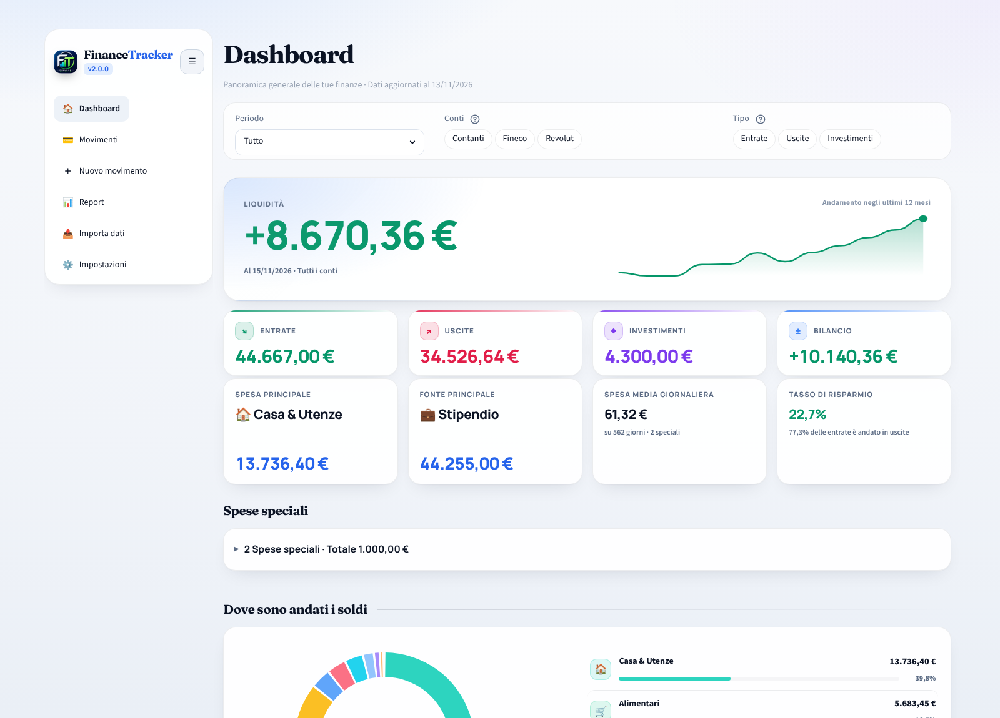
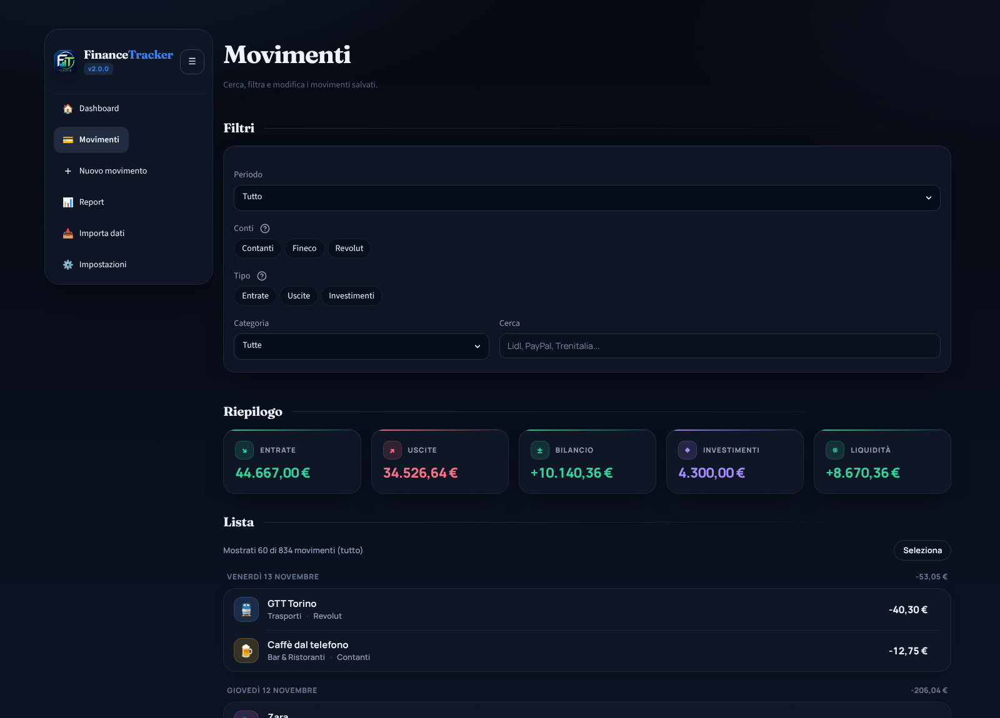
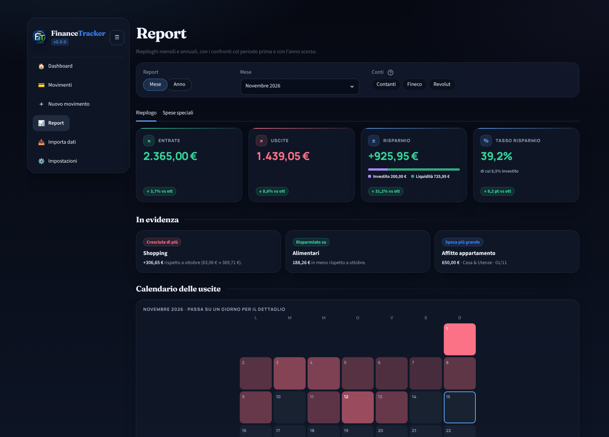
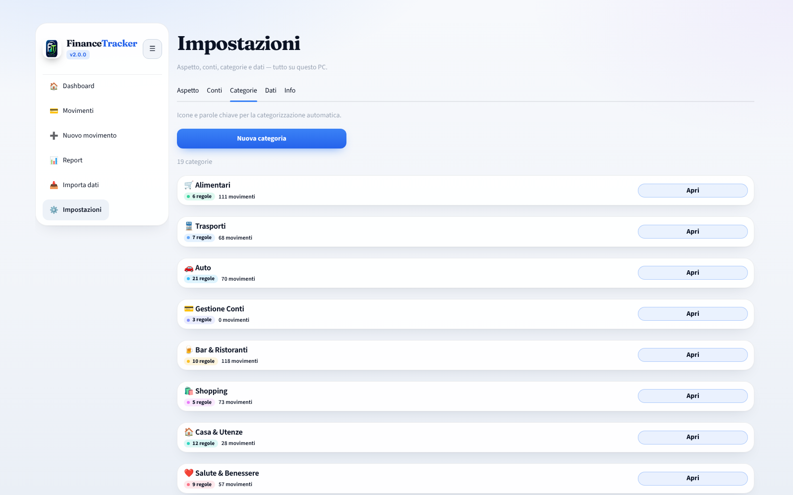
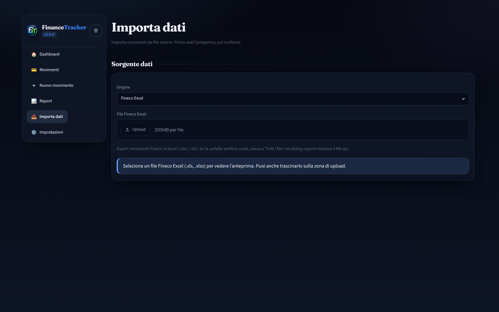
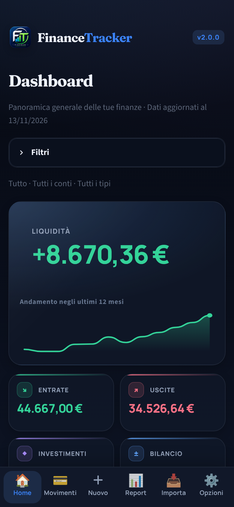
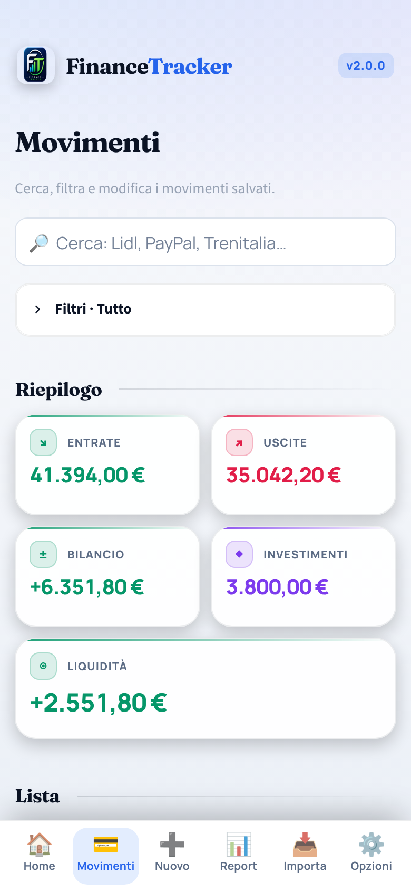
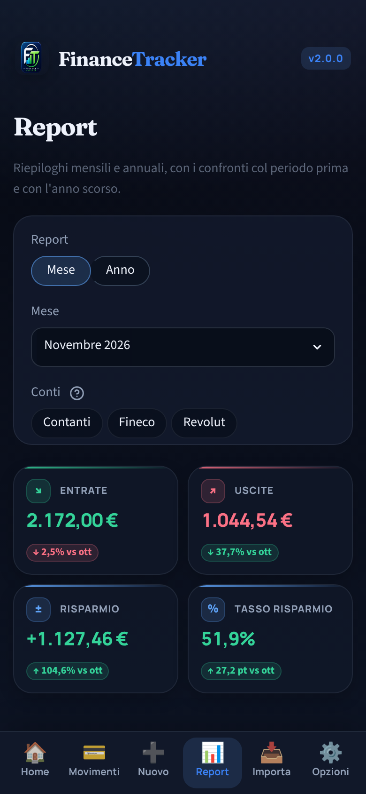

# 💰 FinanceTracker

FinanceTracker è un'app sviluppata in Python per gestire le proprie finanze personali in modo semplice, moderno e completamente offline, per desktop (Windows, Linux, macOS) e Android.

## ✨ Funzionalità

- 📊 **Dashboard**: bilancio del periodo con l'andamento degli ultimi 12 mesi, entrate, uscite, investimenti e liquidità con il confronto col periodo prima
- 🗓️ **Report** mensili e annuali: confronti col mese/anno prima e con l'anno scorso, cose in evidenza, calendario delle spese, uscite anno su anno
- 🥧 Dove vanno e da dove arrivano i soldi, andamento mensile (grafici che si leggono al passaggio del mouse o al tocco)
- 💳 **Movimenti** raggruppati per giorno, con ricerca e filtri per conto, tipo, categoria e periodo; modifica, dividi, unisci, annulla
- 🏦 Liquidità reale per conto (trasferimenti e saldo iniziale inclusi)
- ⭐ Spese speciali (ripartizione su mesi o esclusione dalla media giornaliera)
- 🔁 Trasferimenti interni e anticipi & recuperi fuori da entrate/uscite
- 📥 Import estratti conto (Fineco, Revolut, PostePay, PayPal) e inserimento manuale
- 🏷️ Categorie e parole chiave per la categorizzazione automatica
- ☁️ **PC ↔ telefono con Google Drive**: il backup si invia a una cartella di Drive e si unisce dall'altra parte; arrivano anche modifiche e cancellazioni (vince la più recente)
- 💾 Backup / ripristino e export Excel brandizzato
- 🎨 Tema chiaro e scuro, quattro colori d'accento
- 📱 App Android con interfaccia pensata per il touch
- 🔒 I dati restano sul tuo dispositivo, senza account; Google Drive solo se lo usi tu per i backup

## 📱 Android

L'app Android ha le stesse pagine del desktop, con un'impaginazione pensata per il touch:
barra di navigazione in basso, card in griglia, filtri richiudibili e grafici che si leggono al tocco.
Funziona **senza internet**: Python e Streamlit girano dentro l'app.

- Si installa dall'APK allegato alle **Releases** (Android 10 o successivo)
- I dati restano nella memoria privata dell'app; backup ed export Excel vanno in **Download** oppure, per il backup, direttamente su **Google Drive** (☁️ Salva su Drive)
- Blocco facoltativo con **impronta, volto o PIN** del telefono
- Il primo avvio richiede 10–30 secondi, il tempo di caricare Python; dal background la riapertura è immediata
- Per tenere allineati PC e telefono: backup su Google Drive e **Unisci** dall'altra parte (vedi [MANUAL.md](MANUAL.md))

Build, firma e dettagli tecnici: **[android/README.md](android/README.md)**.

## 🖥️ Tecnologie

- Python
- Streamlit
- SQLite
- Grafici SVG disegnati nel browser (componenti Streamlit), senza librerie esterne
- PyWebView (desktop)
- stlite + Pyodide (Android: Streamlit e Python in WebAssembly)

## 📷 Screenshot

### Dashboard

### Movimenti

### Report

### Gestione categorie

### Importa dati

### Android

  
  
  

*Screenshot con dati di esempio.*

## 📖 Manuale

Categorie speciali (anticipi, rimborsi, trasferimenti, …), report, PC ↔ telefono con Google Drive, dividere e unire movimenti, import: **[MANUAL.md](MANUAL.md)**.

## 🚀 Download

Scarica l'ultima versione dalla sezione **Releases**:

| Sistema | File |
|---|---|
| **Windows** | `FinanceTracker_Setup_*.exe` |
| **Linux** | `financetracker_*.deb` |
| **macOS** | `FinanceTracker_*_macos_*.zip` |
| **Android** | `FinanceTracker-*-android.apk` |

## 📂 Dove vengono salvati i dati

Tutti i dati restano in locale sul dispositivo. Sul PC, nella cartella dell'app trovi:

- `finance_tracker.db` — database
- `categories.json` — categorie e parole chiave
- `backups/` — backup
- `logs/` — log dell'applicazione

| Sistema | Percorso |
|---|---|
| **Windows** | `%LOCALAPPDATA%\FinanceTracker\` |
| **Linux** | `~/.local/share/FinanceTracker/` |
| **macOS** | `~/Library/Application Support/FinanceTracker/` |

Su Windows il percorso completo tipico è:
`C:\Users\<utente>\AppData\Local\FinanceTracker\`

Su **Android** database e categorie stanno nella memoria privata dell'app (non vanno su internet e sono
esclusi dal backup automatico di Google); backup ed export Excel finiscono in **Download**, oppure il backup
su **Google Drive** se scegli ☁️ Salva su Drive. Disinstallando l'app i dati si perdono: ricordati di fare
ogni tanto un backup.

Se imposti la **cartella condivisa** (Impostazioni → Dati → Backup), i backup che invii dal PC finiscono
anche lì; ne restano gli ultimi 10 per dispositivo.

## 📄 Licenza

Questo progetto è distribuito sotto licenza MIT.
