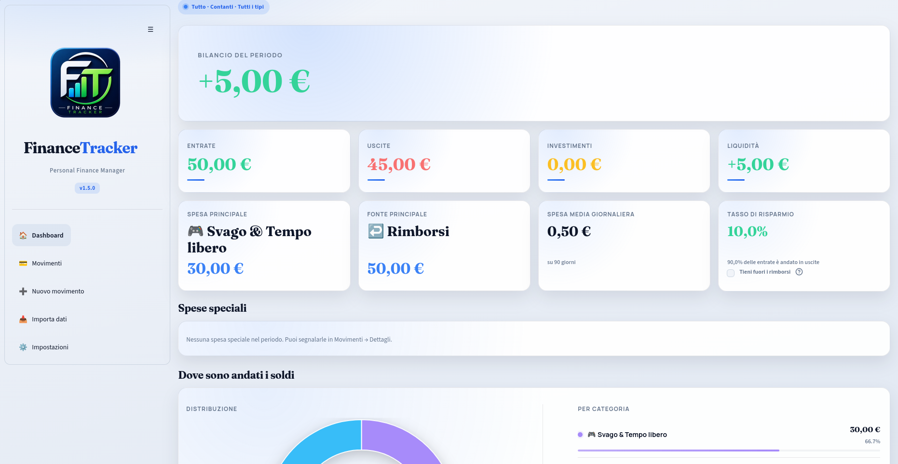
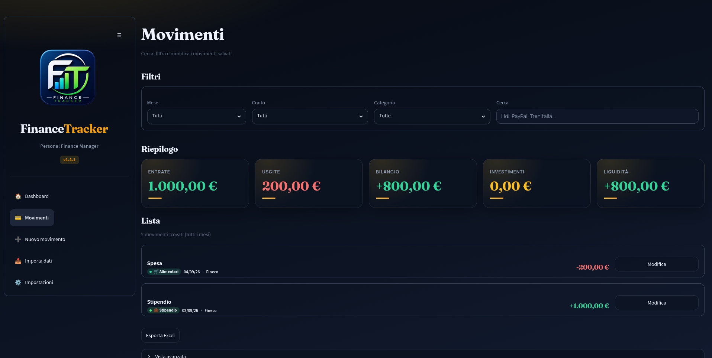
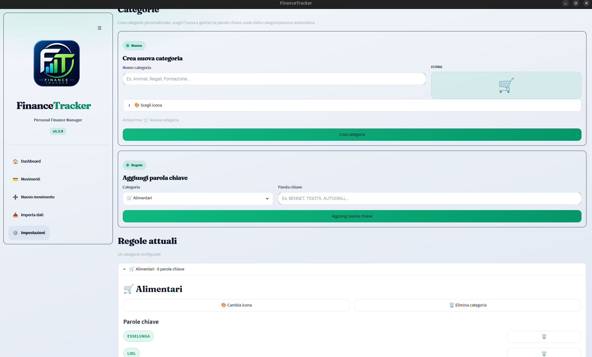
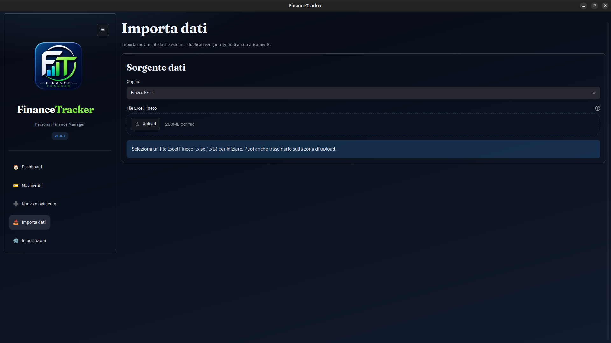

# 💰 FinanceTracker

FinanceTracker è un'app sviluppata in Python per gestire le proprie finanze personali in modo semplice, moderno e completamente offline, per desktop (Windows, Linux, macOS) e Android.

## ✨ Funzionalità

- 📊 Dashboard con KPI, confronti periodo e grafici
- 🏦 Liquidità reale per conto (trasferimenti e saldo iniziale inclusi)
- 🔎 Filtri per più conti e intervallo personalizzato
- 🥧 Distribuzione spese e andamento mensile
- ⭐ Spese speciali (ripartizione su mesi o esclusione dalla media giornaliera)
- 🔁 Trasferimenti interni tra conti (fuori da entrate/uscite)
- 💳 Import estratti conto (Fineco, Revolut, PostePay, PayPal)
- ✏️ Inserimento movimenti manuali
- 🏷️ Gestione categorie e parole chiave
- 💾 Backup / ripristino e export Excel brandizzato
- 📱 App Android con interfaccia pensata per il touch
- 🔒 Tutti i dati rimangono sul proprio dispositivo (PC o telefono), senza account e senza cloud

## 📱 Android

L'app Android ha le stesse pagine e lo stesso stile del desktop, con un'impaginazione pensata per il touch:
barra di navigazione in basso, card in griglia e grafici che si leggono al tocco.
Funziona **senza internet**: Python e Streamlit girano dentro l'app.

- Si installa dall'APK allegato alle **Releases** (Android 10 o successivo)
- Al primo avvio scegli una **cartella del telefono** per i dati (es. Documenti/FinanceTracker): restano lì anche se disinstalli l'app
- Blocco facoltativo con **impronta, volto o PIN** del telefono
- Il primo avvio richiede 10–30 secondi, il tempo di caricare Python; dal background la riapertura è immediata
- Per portare i dati dal PC al telefono: backup dal desktop, poi **Unisci** da **Opzioni → Dati**

Build, firma e dettagli tecnici: **[android/README.md](android/README.md)**.

## 🖥️ Tecnologie

- Python
- Streamlit
- SQLite
- Plotly
- PyWebView (desktop)
- stlite + Pyodide (Android: Streamlit e Python in WebAssembly)

## 📷 Screenshot

### Dashboard

### Movimenti

### Gestione categorie

### Importa dati

## 📖 Manuale

Categorie speciali (prestiti, rimborsi, trasferimenti, …), split, import: **[MANUAL.md](MANUAL.md)**.

## 🚀 Download

Scarica l'ultima versione dalla sezione **Releases**:

| Sistema | File |
|---|---|
| **Windows** | `FinanceTracker_Setup_*.exe` |
| **Linux** | `financetracker_*.deb` |
| **macOS** | `FinanceTracker_*_macos_*.zip` |
| **Android** | `FinanceTracker-*-android.apk` |

## 📂 Dove vengono salvati i dati

Tutti i dati restano in locale sul dispositivo. Sul PC, nella cartella dell'app trovi:

- `finance_tracker.db` — database
- `categories.json` — categorie e parole chiave
- `backups/` — backup
- `logs/` — log dell'applicazione

| Sistema | Percorso |
|---|---|
| **Windows** | `%LOCALAPPDATA%\FinanceTracker\` |
| **Linux** | `~/.local/share/FinanceTracker/` |
| **macOS** | `~/Library/Application Support/FinanceTracker/` |

Su Windows il percorso completo tipico è:
`C:\Users\<utente>\AppData\Local\FinanceTracker\`

Su **Android** database, categorie e backup stanno nella **cartella del telefono scelta al primo avvio**
(es. `Documenti/FinanceTracker`), con gli stessi nomi del PC, e restano anche se disinstalli l'app.
Se non scegli una cartella, i dati restano solo nella memoria interna dell'app e si perdono disinstallandola;
puoi sceglierla in qualsiasi momento da **Opzioni → Dati**.

## 📄 Licenza

Questo progetto è distribuito sotto licenza MIT.
